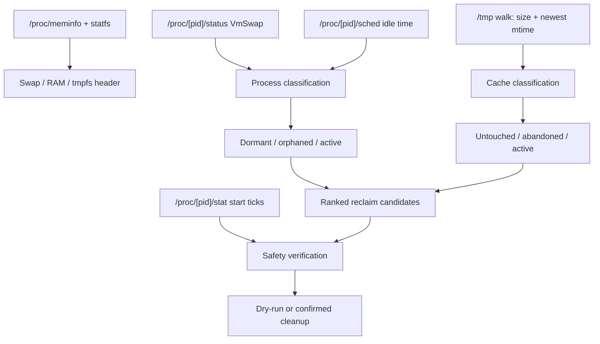

# SwapAudit

**Linux swap, RAM, and tmpfs auditor with guarded cleanup.**

> **Status: public v0.1.0.** The first tagged release is public: four Linux assets, checksums, and cosign signatures. `go install` and `swapaudit upgrade` work without authentication. Cleanup safety hardening is implemented; use `--dry-run` first and review each target. See [`docs/safety.md`](docs/safety.md), [`docs/releases/v0.1.0.md`](docs/releases/v0.1.0.md), and [`goals/README.md`](goals/README.md).

## The answer

When `free` says swap is full, most tools tell you the total. SwapAudit tells you **which processes and `/tmp` caches are responsible, and what you can safely reclaim now** — in one pass, with no daemon and no external dependencies.

```
                  ANSWER
        What can I safely reclaim now?
                 /        \
              SEE          ACT
        swap + tmpfs    dry-run → confirm → reclaim
             /   \          /        \
      VmSwap   cache    classify    guard
      /proc    mtime    cleanable   PID/path/UID
```

## The case, in Minto order

### Situation

Modern Linux workstations run language servers, containers, headless browsers, and local AI agent workers. Inactive processes accumulate anonymous pages that the kernel pages out to swap. Build and test runs leave gigabytes in `/tmp`, which is often a RAM-backed tmpfs. Under pressure, swap and tmpfs compete for the same physical memory.

### Complication

The standard tools answer the wrong question:

- `free`, `top`, and `vmstat` report **aggregate** swap or resident memory.
- `ps_mem` can show swap, but it does not explain `/tmp` or provide guarded cleanup.
- `smem` reports PSS/USS and explicitly **excludes swapped-out memory**.
- `systemd-tmpfiles` cleans files by age, but knows nothing about processes or swap.
- `earlyoom` and `systemd-oomd` kill under pressure, but do not attribute memory or let you choose a safe cleanup.

So the operator still has to answer the real question manually: *what is actually in swap and `/tmp`, and what can I remove without breaking my work?*

### Question

Which process or cache is consuming swap and tmpfs, and what is safe to reclaim right now?

### Answer

SwapAudit. It reads `/proc`, ranks swap and `/tmp` occupants, classifies the safe candidates, and offers a guarded cleanup path with a dry-run, confirmation prompts, PID start-ticks verification, path confinement, and symlink/UID checks.

## What the answer is built on

| Layer | What it does | Evidence |
| --- | --- | --- |
| **See** | Per-process `VmSwap` from `/proc/[pid]/status`; `/tmp` size and newest mtime from a recursive walk; system swap/RAM/tmpfs from `/proc/meminfo` and `statfs` | `internal/proc`, `internal/cache` |
| **Decide** | Classifies untouched caches, abandoned runs, dormant agents, orphaned agents, active caches, desktop daemons, and active apps | `internal/triage` |
| **Act** | Dry-run, confirmation prompts, `SIGTERM` only after re-reading start ticks, `os.RemoveAll` only inside confined paths | `internal/cleaner` |
| **Explain** | Ranked tables, category totals, shell aggregation, `NO_COLOR`, ASCII fallback, terminal-width adaptation | `internal/app`, `internal/term` |

**Measured on the reference host:** a full audit completed in 81 ms; the binary is a 6.6 MB static x86-64 build with zero non-standard-library dependencies. This is one host observation, not a universal benchmark.

## How it compares

| Tool | Per-process swap | `/tmp` aging | Agent-aware cleanup | Guarded process termination | Cost |
| --- | :---: | :---: | :---: | :---: | --- |
| **SwapAudit** | Yes | Yes (`/tmp`) | Partial — 4 runtimes | Yes — dry-run, start ticks, process/file UID, path/symlink | Free, WaqfDPL/AGPL |
| `ps_mem` | Yes (`--swap`) | No | No | No | Free, LGPL-2.1 |
| `smem` | No — PSS/USS exclude swap | No | No | No | Free, GPLv2+ |
| `systemd-tmpfiles` | No | Yes | No | OS policy | Bundled with systemd |
| `earlyoom` / `systemd-oomd` | No attribution | No | No | Kill daemon/cgroup | Free/bundled |

The wedge is not "another memory report." It is the combination of **swap attribution, tmpfs discovery, and a guarded cleanup decision** in one CLI.

## Quick start

Install the release binary:

```bash
curl -fsSL https://github.com/jadmadi/SwapAudit/releases/download/v0.1.0/swapaudit-linux-amd64 \
  -o ~/.local/bin/swapaudit
chmod +x ~/.local/bin/swapaudit
swapaudit --no-color
```

Or install with Go:

```bash
go install github.com/jadmadi/swapaudit/cmd/swapaudit@v0.1.0
```

Or build from source:

```bash
git clone https://github.com/jadmadi/SwapAudit.git
cd SwapAudit
make build
make install
```

Requirements: Linux with `/proc`; **Linux 3.14+ recommended** because the RAM-used calculation uses `MemAvailable`. The release build uses `CGO_ENABLED=0`.

## Verify a release

```bash
./scripts/verify-release.sh v0.1.0
```

The script checks the four architecture assets over the public internet, verifies `checksums.txt`, runs the amd64 binary, verifies the cosign signature when cosign is installed, and runs `go install @v0.1.0`.

Manual checksum check:

```bash
mkdir -p dist
curl -fsSL https://github.com/jadmadi/SwapAudit/releases/download/v0.1.0/checksums.txt -o dist/checksums.txt
curl -fsSL https://github.com/jadmadi/SwapAudit/releases/download/v0.1.0/swapaudit-linux-amd64 -o dist/swapaudit-linux-amd64
(cd dist && sha256sum -c checksums.txt --ignore-missing)
./dist/swapaudit-linux-amd64 --version
```

The release is signed with cosign keyless in GitHub Actions.

| Architecture | Release asset |
| --- | --- |
| amd64 | `swapaudit-linux-amd64` |
| arm64 | `swapaudit-linux-arm64` |
| armv7 | `swapaudit-linux-armv7` |
| riscv64 | `swapaudit-linux-riscv64` |

## First run

```bash
# Full audit
swapaudit

# Inspect everything without shell aggregation
swapaudit --all

# Sort by process age instead of size
swapaudit --sort age

# Preview every cleanup action without deleting or signaling
swapaudit --dry-run --clean-all
```

Example output (illustrative):

```text
+--------------------------------------------------------------------------------------------------+
| *  SWAP & IN-MEMORY CACHE AUDITOR                                                                |
+--------------------------------------------------------------------------------------------------+
  Swap     [#######.........]  48.5%   8.3 GB /  17.1 GB (free 8.8 GB)
  RAM used [######..........]  39.2%  12.2 GB /  31.2 GB (avail 19.0 GB)
  /tmp     [#######.........]  47.7%   7.4 GB /  15.6 GB (free 8.2 GB)
  Pressure: green <50% · amber 50–79% · red ≥80%

  Verdict: Swap 48.5% used · 1.9 GB reclaimable (1.1 GB tmpfs + 815.0 MB swap; upper bound; pools may overlap) ·
  biggest win: agy PID 2603976 (582.3 MB) · thresholds: cache 12h, agent 2h, orphan-cache 1h

  Swap:  2.9 GB attributed + 5.4 GB unattributed = 8.3 GB used
  /tmp:  4.2 GB attributed + 1.0 GB unattributed = 5.2 GB used
  unattributed reasons: other-uid 800.0 MB · non-matching 150.0 MB · metadata-or-other 40.0 MB
  Reconciles: OK

+--------------------------------------------------------------------------------------------------+
| *  Actionable Reclaim Candidates                                                                 |
+--------------------------------------------------------------------------------------------------+
  Reclaimable: 1.1 GB tmpfs · 815.0 MB swap (upper bound; pools may overlap)

  ID       | Target / Name      | Category         |         Idle | Action               |    Reclaim
  ---------+--------------------+------------------+--------------+----------------------+-----------
           | agy ×3             | dormant-agents   |    6h44–7h12 | End dormant session  |   736.2 MB
  ...
  Actionable population: 8 cleanable · 8 shown (2 rows) · 0 hidden (0 B) · limit 12 rows
```

## Safety model

### Guards

- **Dry-run first:** `--dry-run` never calls `syscall.Kill` or `os.RemoveAll`.
- **PID reuse protection:** the cleaner re-reads `/proc/[pid]/stat` start ticks immediately before `SIGTERM`.
- **PID floors:** PID `<= 1` and the current process are skipped.
- **UID ownership:** process targets must match the current real UID. `--all-users` is required for another user's processes and prints a warning once per group.
- **Path confinement:** file cleanup is limited to `/tmp/`, `/var/tmp/`, or `os.TempDir()`.
- **Symlink rejection:** top-level symlink targets are rejected; `WalkDir` does not follow symlinks.
- **File ownership:** file targets are checked against the current UID before removal.
- **Orphan evidence:** a process is orphaned only when the cgroup/tty evidence indicates a reparented terminal session. `.service` cgroups, missing terminals, and ambiguous evidence fail closed.
- **Orphan opt-in:** `--clean-all` covers untouched caches, abandoned runs, and dormant agents only. Use `--include-orphaned` with `--clean-all`, or `--clean-orphaned` alone. Orphaned caches use a separate `--clean-orphaned-caches` opt-in.
- **Liveness before age:** a cache with an open descriptor, a process cwd, or a file-backed mapping is `in-use-caches` and is never cleanable, regardless of mtime. Orphaned caches are rechecked immediately before deletion and fail closed if the `/proc` index is incomplete.
- **Parent and idle rechecks:** before `SIGTERM`, the cleaner re-reads parent liveness, orphan evidence, idle evidence, UID, and start ticks. Dormant targets with a live parent are skipped unless `--allow-live-parent` is explicit; orphaned targets with a live parent are always skipped.
- **Zero-swap visibility:** agents with `VmSwap == 0` are still scanned, classified, and shown in the agent population and actionable table. Cleanup of a zero-swap orphan is an explicit process action with `0 B` swap reclaimed.
- **Non-interactive guard:** cleanup from a non-TTY stdin requires `--dry-run` or `--yes`; otherwise the command exits `2` before scanning or mutating anything.
- **Signal label:** every process action prints `SIGTERM` in both dry-run (`would-signal`) and live (`signaled`) output. There is no `SIGKILL`.
- **Confirmation:** each cleanup group prompts unless `--yes` is set.
- **Signal caveat:** `SIGTERM` can lose unsaved in-memory agent state. SwapAudit does not verify conversation persistence.

The full contract, including the manual systemd/other-UID verification protocol, is in [`docs/safety.md`](docs/safety.md).

**Recommended workflow:** run `--dry-run`, review every target, then run one category at a time as your normal user.

## What it detects

| Category | Examples | Cleanable |
| --- | --- | --- |
| `untouched-caches` | `go-build*`, build caches beyond `--max-age` | After `--max-age` with no nested writes |
| `abandoned-runs` | `test*`, `tmp-*`, `tsx-*`, `npm-*`, custom `--tmp-pattern` | After `--max-age` with no nested writes |
| `orphaned-caches` | Build/run caches with no open handle, cwd, or mapping and idle beyond `--orphan-cache-age` | Opt-in only with `--clean-orphaned-caches` (or `--include-orphaned-caches` + `--clean-all`) |
| `in-use-caches` | Caches with an open fd, process cwd, or file-backed mapping | Never |
| `recent-caches` | Recently written caches | Protected |
| `dormant-agents` | `agy`, `devin`, `chrome-devtools`, `antigravity` | Idle beyond `--idle-threshold` |
| `abandoned-agents` | Same runtimes with cgroup/tty evidence of a reparented terminal session | Evidence-gated; ambiguous cases are protected |
| `desktop-daemons` | KDE, systemd, dbus, pipewire and similar | Protected |
| `active-apps` | Everything else | Protected |

**Scope limits, stated plainly:**

- Scans `/tmp`, not `/var/tmp`.
- Only the four agent runtimes above are classified. Claude Code, Codex, Cursor, Windsurf, Cline, Aider, OpenCode, Gemini, and others are not yet detected as agents.
- Linux only. No Windows/macOS, no GUI, no daemon.
- No package-manager package yet.

## CLI reference

| Command or flag | Default | Description |
| --- | --- | --- |
| `upgrade` | — | Check GitHub releases and replace the binary (requires a published release) |
| `--sort <size or age>` | `size` | Sort the occupant table |
| `--limit <N>` | `12` | Maximum rows per table; `0` means unlimited |
| `--all` | `false` | Show all items; disables shell aggregation, grouping, and the 10 MB filter |
| `--no-group` | `false` | Expand every grouped cache/process pattern |
| `--expand <key>` | — | Expand one group key (prefix match) |
| `--collapse` | `false` | Collapse groups (default) |
| `--wide`, `--no-truncate` | `false` | Full names; may exceed the terminal width |
| `--explain-agents` | `false` | Print per-agent parent/idle/tty/cgroup/reason evidence |
| `--explain-caches` | `false` | Print per-cache liveness evidence |
| `--clean-untouched` | `false` | Prune stale build caches beyond `--max-age` |
| `--clean-abandoned` | `false` | Prune abandoned test/review runs in `/tmp` |
| `--clean-dormant` | `false` | `SIGTERM` dormant agent sessions beyond `--idle-threshold` |
| `--clean-orphaned` | `false` | `SIGTERM` evidence-gated orphaned agent sessions |
| `--clean-orphaned-caches` | `false` | Prune orphaned caches with no open handles (opt-in) |
| `--clean-tmp` | `false` | Prune untouched and abandoned `/tmp` caches |
| `--clean-all` | `false` | Untouched + abandoned + dormant cleanup; excludes orphaned agents and caches |
| `--include-orphaned` | `false` | Include orphaned agent cleanup with `--clean-all` |
| `--include-orphaned-caches` | `false` | Include orphaned cache cleanup with `--clean-all` |
| `--allow-live-parent` | `false` | Allow ending a dormant agent whose parent is alive |
| `--allow-generic-caches` | `false` | Permit generic cache classification and cleanup |
| `--all-users` | `false` | Allow signaling processes owned by other UIDs |
| `--dry-run` | `false` | Preview without deleting or signaling |
| `-y`, `--yes` | `false` | Skip confirmation prompts |
| `--max-age <duration>` | `12h` | Stale-cache cutoff |
| `--idle-threshold <duration>` | `2h` | Dormant-agent cutoff |
| `--orphan-cache-age <duration>` | `1h` | Orphaned-cache idle cutoff; must be `<= --max-age` |
| `--tmp-pattern <pattern>` | built-in list | Additional `/tmp` pattern (repeatable) |
| `--json` | `false` | Emit one versioned JSON object on stdout |
| `--check-updates` | `false` | One explicit GitHub release check; see `PRIVACY.md` |
| `--ascii` | `false` | Plain ASCII output |
| `--no-color` | `false` | Disable ANSI color (also honors `NO_COLOR`) |
| `-v`, `--version` | `false` | Print version and build metadata |
| `-h`, `--help` | `false` | Show usage |

Exit codes: `0` success, `1` runtime failure, `2` usage error, `3` cleanup partial failure.

## What the numbers mean

Every displayed byte is one of three things: a kernel total, a category sum, or an explicit `unattributed`/`overlap` residual. The tool never silently drops the difference between a header total and the scanned subset.

- **Swap header** = `SwapTotal - SwapFree` from `/proc/meminfo`.
- **Process swap** = the sum of `VmSwap` from `/proc/[pid]/status`; it may include shared pages, so it is labelled *attributed* and shown with a residual.
- **/tmp header** = `statfs` used blocks. **Cache sizes** are allocated blocks (`Stat_t.Blocks * 512`), not apparent size; sparse files cannot inflate the reclaim estimate.
- **Cleanable** is split by pool: tmpfs and swap are shown side by side and never added into a single primary number. They can overlap physically.
- **Counts** are explained with population lines: raw items, after aggregation/grouping, shown, hidden below the 10 MB filter, and hidden beyond `--limit`.

The full metric dictionary and caveats (shared swap, shmem, tmpfs swap, other UIDs, daemon prefixes, dotfiles, non-matching names, directory metadata, hard links) is in [`docs/metrics.md`](docs/metrics.md). Cache liveness rules are in [`docs/cache-liveness.md`](docs/cache-liveness.md), and the output layout contract is in [`docs/output-layout.md`](docs/output-layout.md).

## Machine-readable audit

```bash
swapaudit --json | jq '{used: .system.swap.used_bytes, reclaim: .reclaim, agents: .population.agents}'
swapaudit --json --dry-run --clean-all | jq '.cleanup'
```

`--json` writes exactly one object to stdout; diagnostics go to stderr. It implies no color and no human banner. Live JSON cleanup requires `--yes` or `--dry-run`. The schema, sorting rules, nullability, and exit-code matrix are in [`docs/json-schema.md`](docs/json-schema.md).

## Update checks and privacy

The default audit performs **no network I/O**.

```bash
# One explicit update check
swapaudit --check-updates

# Equivalent opt-in for scripts
SWAPAUDIT_CHECK_UPDATES=1 swapaudit
```

The check performs one `GET` to the GitHub release API, sends `User-Agent: swapaudit`, and does not send the local version, hostname, username, or usage data. It writes a small state file under `$XDG_CACHE_HOME/swapaudit/` or `~/.cache/swapaudit/`. The full contract is in [`PRIVACY.md`](PRIVACY.md).

`swapaudit upgrade` is separate: it always uses the network because it downloads and verifies a release binary.

## How it works



### Project layout

- `cmd/swapaudit` — entry point.
- `internal/app` — flag parsing, orchestration, tables, help.
- `internal/cache` — `/tmp` scan, patterns, recursive mtime.
- `internal/cleaner` — pruning, `SIGTERM`, safety checks.
- `internal/model` — shared types.
- `internal/proc` — `/proc` parsers.
- `internal/term` — terminal layout, color, width.
- `internal/triage` — classification and shell aggregation.
- `internal/updater` — release check and atomic self-upgrade.
- `internal/version` — version/build metadata.

## Status and roadmap

- **Stage:** public v0.1.0 release.
- **Completed:** cleanup safety, update-check privacy, security contacts, and the public release.
- **In progress:** demand validation. The public install test is complete; five interviews and the 14-day download/issue measurement remain.
- **Feature freeze:** no new scanners, agent runtimes, JSON, package managers, GUI, daemon, telemetry, or pricing work until [`public-install-demand-validation`](goals/public-install-demand-validation/goal.md) is certified.
- **Goal index:** [`goals/README.md`](goals/README.md).

## Support and security

- **Bugs and feature requests:** GitHub Issues using the templates.
- **Security vulnerabilities:** [GitHub Private Vulnerability Reporting](https://github.com/jadmadi/SwapAudit/security/advisories/new) is primary; `contact@jadmadi.net` is the fallback. Do not open a public issue for a vulnerability. See [`SECURITY.md`](SECURITY.md).
- **General support:** [`SUPPORT.md`](SUPPORT.md). Support is best-effort; there is no SLA.
- **Conduct:** [`CODE_OF_CONDUCT.md`](CODE_OF_CONDUCT.md) or `contact@jadmadi.net`.

## Development

```bash
./scripts/check.sh --quick   # fast formatting + tests
./scripts/check.sh --full    # format, vet, lint, race tests, build
go test -race ./...
go vet ./...
```

Contribution rules: [`CONTRIBUTING.md`](CONTRIBUTING.md). Governance: [`GOVERNANCE.md`](GOVERNANCE.md). Security: [`SECURITY.md`](SECURITY.md).

## License

SwapAudit is dual-licensed under:

1. **Waqf Digital Public License, Level 2: Binding Attribution (WaqfDPL-Mulzim 1.0)** — a perpetual digital endowment (Waqf) requiring reciprocal copyleft and attribution. See [`WaqfDPL-1.0.md`](WaqfDPL-1.0.md).
2. **GNU Affero General Public License v3.0 or later (AGPL-3.0-or-later)** — see [`LICENSE-AGPL.txt`](LICENSE-AGPL.txt).

You may choose either license. Author: Jad Madi ([@jadmadi](https://github.com/jadmadi)).
