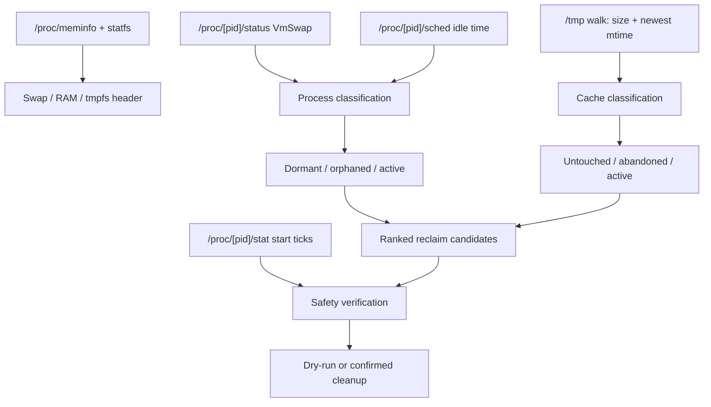

# SwapAudit

**Linux swap, RAM, and tmpfs auditor with guarded cleanup.**

> **Status: private, pre-v0.1.0.** The source builds and runs, but release binaries, `go install`, and self-upgrade are not published yet. Cleanup safety hardening is implemented; use `--dry-run` first and review each target. See [`docs/safety.md`](docs/safety.md) and [`goals/README.md`](goals/README.md).

## The answer

When `free` says swap is full, most tools tell you the total. SwapAudit tells you **which processes and `/tmp` caches are responsible, and what you can safely reclaim now** — in one pass, with no daemon and no external dependencies.

```
                  ANSWER
        What can I safely reclaim now?
                 /        \
              SEE          ACT
        swap + tmpfs    dry-run → confirm → reclaim
             /   \          /        \
      VmSwap   cache    classify    guard
      /proc    mtime    cleanable   PID/path/UID
```

## The case, in Minto order

### Situation

Modern Linux workstations run language servers, containers, headless browsers, and local AI agent workers. Inactive processes accumulate anonymous pages that the kernel pages out to swap. Build and test runs leave gigabytes in `/tmp`, which is often a RAM-backed tmpfs. Under pressure, swap and tmpfs compete for the same physical memory.

### Complication

The standard tools answer the wrong question:

- `free`, `top`, and `vmstat` report **aggregate** swap or resident memory.
- `ps_mem` can show swap, but it does not explain `/tmp` or provide guarded cleanup.
- `smem` reports PSS/USS and explicitly **excludes swapped-out memory**.
- `systemd-tmpfiles` cleans files by age, but knows nothing about processes or swap.
- `earlyoom` and `systemd-oomd` kill under pressure, but do not attribute memory or let you choose a safe cleanup.

So the operator still has to answer the real question manually: *what is actually in swap and `/tmp`, and what can I remove without breaking my work?*

### Question

Which process or cache is consuming swap and tmpfs, and what is safe to reclaim right now?

### Answer

SwapAudit. It reads `/proc`, ranks swap and `/tmp` occupants, classifies the safe candidates, and offers a guarded cleanup path with a dry-run, confirmation prompts, PID start-ticks verification, path confinement, and symlink/UID checks.

## What the answer is built on

| Layer | What it does | Evidence |
| --- | --- | --- |
| **See** | Per-process `VmSwap` from `/proc/[pid]/status`; `/tmp` size and newest mtime from a recursive walk; system swap/RAM/tmpfs from `/proc/meminfo` and `statfs` | `internal/proc`, `internal/cache` |
| **Decide** | Classifies untouched caches, abandoned runs, dormant agents, orphaned agents, active caches, desktop daemons, and active apps | `internal/triage` |
| **Act** | Dry-run, confirmation prompts, `SIGTERM` only after re-reading start ticks, `os.RemoveAll` only inside confined paths | `internal/cleaner` |
| **Explain** | Ranked tables, category totals, shell aggregation, `NO_COLOR`, ASCII fallback, terminal-width adaptation | `internal/app`, `internal/term` |

**Measured on the reference host:** a full audit completed in 81 ms with `--no-update-check`; the binary is a 6.6 MB static x86-64 build with zero non-standard-library dependencies. This is one host observation, not a universal benchmark.

## How it compares

| Tool | Per-process swap | `/tmp` aging | Agent-aware cleanup | Guarded process termination | Cost |
| --- | :---: | :---: | :---: | :---: | --- |
| **SwapAudit** | Yes | Yes (`/tmp`) | Partial — 4 runtimes | Yes — dry-run, start ticks, path/UID; process UID pending | Free, WaqfDPL/AGPL |
| `ps_mem` | Yes (`--swap`) | No | No | No | Free, LGPL-2.1 |
| `smem` | No — PSS/USS exclude swap | No | No | No | Free, GPLv2+ |
| `systemd-tmpfiles` | No | Yes | No | OS policy | Bundled with systemd |
| `earlyoom` / `systemd-oomd` | No attribution | No | No | Kill daemon/cgroup | Free/bundled |

The wedge is not "another memory report." It is the combination of **swap attribution, tmpfs discovery, and a guarded cleanup decision** in one CLI.

## Quick start

The repository is private. Authenticate with GitHub first.

```bash
git clone https://github.com/jadmadi/SwapAudit.git
cd SwapAudit
make build
./swapaudit --no-update-check --no-color
```

Install to `~/.local/bin`:

```bash
make install
```

Requirements: Linux with `/proc`; **Linux 3.14+ recommended** because the RAM-used calculation uses `MemAvailable`. The release build uses `CGO_ENABLED=0`.

> **Release binaries:** not published yet. The v0.1.0 release goal is [`goals/standalone-v0-1-0-release/goal.md`](goals/standalone-v0-1-0-release/goal.md). `swapaudit upgrade` is implemented but cannot work until a release exists.

## First run

```bash
# Full audit
swapaudit

# Inspect everything without shell aggregation
swapaudit --all

# Sort by process age instead of size
swapaudit --sort age

# Preview every cleanup action without deleting or signaling
swapaudit --dry-run --clean-all
```

Example output (illustrative):

```text
+--------------------------------------------------------------------------------------------------+
| *  SWAP & IN-MEMORY CACHE AUDITOR                                                                |
+--------------------------------------------------------------------------------------------------+
  Swap  [#######.........]  48.5%   8.3 GB /  17.1 GB (free 8.8 GB)
  RAM   [######..........]  39.2%  12.2 GB /  31.2 GB (avail 19.0 GB)
  /tmp  [#######.........]  47.7%   7.4 GB /  15.6 GB (free 8.2 GB)

+--------------------------------------------------------------------------------------------------+
| *  Actionable Reclaim Candidates (Cleanable: 5.9 GB)                                             |
+--------------------------------------------------------------------------------------------------+
  PID       | Target / Name      | Category         |       Size |     Idle | Action
  ----------+--------------------+------------------+------------+----------+-----------------------
  > 2603976 | agy                | dormant-agents   |   338.8 MB |   20h45m | End dormant session
  > -       | go-build704621508  | untouched-caches |   338.7 MB |   20h46m | Prune untouched cache
  ... and 652 smaller candidates (1.9 GB). Run with --all to inspect full list.
```

## Safety model

### Guards

- **Dry-run first:** `--dry-run` never calls `syscall.Kill` or `os.RemoveAll`.
- **PID reuse protection:** the cleaner re-reads `/proc/[pid]/stat` start ticks immediately before `SIGTERM`.
- **PID floors:** PID `<= 1` and the current process are skipped.
- **UID ownership:** process targets must match the current real UID. `--all-users` is required for another user's processes and prints a warning once per group.
- **Path confinement:** file cleanup is limited to `/tmp/`, `/var/tmp/`, or `os.TempDir()`.
- **Symlink rejection:** top-level symlink targets are rejected; `WalkDir` does not follow symlinks.
- **File ownership:** file targets are checked against the current UID before removal.
- **Orphan evidence:** a process is orphaned only when the cgroup/tty evidence indicates a reparented terminal session. `.service` cgroups, missing terminals, and ambiguous evidence fail closed.
- **Orphan opt-in:** `--clean-all` covers untouched caches, abandoned runs, and dormant agents only. Use `--include-orphaned` with `--clean-all`, or `--clean-orphaned` alone.
- **Confirmation:** each cleanup group prompts unless `--yes` is set.
- **Signal caveat:** `SIGTERM` can lose unsaved in-memory agent state. SwapAudit does not verify conversation persistence.

The full contract, including the manual systemd/other-UID verification protocol, is in [`docs/safety.md`](docs/safety.md).

**Recommended workflow:** run `--dry-run`, review every target, then run one category at a time as your normal user.

## What it detects

| Category | Examples | Cleanable |
| --- | --- | --- |
| `untouched-caches` | `go-build*`, directories containing `cache` | After `--max-age` with no nested writes |
| `abandoned-runs` | `test*`, `tmp-*`, `tsx-*`, `npm-*`, custom `--tmp-pattern` | After `--max-age` with no nested writes |
| `dormant-agents` | `agy`, `devin`, `chrome-devtools`, `antigravity` | Idle beyond `--idle-threshold` |
| `abandoned-agents` | Same runtimes with cgroup/tty evidence of a reparented terminal session | Evidence-gated; ambiguous cases are protected |
| `active-caches` | Recently written caches | Protected |
| `desktop-daemons` | KDE, systemd, dbus, pipewire and similar | Protected |
| `active-apps` | Everything else | Protected |

**Scope limits, stated plainly:**

- Scans `/tmp`, not `/var/tmp`.
- Only the four agent runtimes above are classified. Claude Code, Codex, Cursor, Windsurf, Cline, Aider, OpenCode, Gemini, and others are not yet detected as agents.
- Linux only. No Windows/macOS, no GUI, no daemon.
- No JSON output yet.
- No package-manager package yet.

## CLI reference

| Command or flag | Default | Description |
| --- | --- | --- |
| `upgrade` | — | Check GitHub releases and replace the binary (requires a published release) |
| `--sort <size or age>` | `size` | Sort the occupant table |
| `--limit <N>` | `12` | Maximum rows in the main table |
| `--all` | `false` | Show individual processes without shell aggregation |
| `--clean-untouched` | `false` | Prune stale build caches beyond `--max-age` |
| `--clean-abandoned` | `false` | Prune abandoned test/review runs in `/tmp` |
| `--clean-dormant` | `false` | `SIGTERM` dormant agent sessions beyond `--idle-threshold` |
| `--clean-orphaned` | `false` | `SIGTERM` evidence-gated orphaned agent sessions |
| `--clean-tmp` | `false` | Prune untouched and abandoned `/tmp` caches |
| `--clean-all` | `false` | Untouched + abandoned + dormant cleanup; excludes orphaned |
| `--include-orphaned` | `false` | Include orphaned cleanup with `--clean-all` |
| `--all-users` | `false` | Allow signaling processes owned by other UIDs |
| `--dry-run` | `false` | Preview without deleting or signaling |
| `-y`, `--yes` | `false` | Skip confirmation prompts |
| `--max-age <duration>` | `12h` | Stale-cache cutoff |
| `--idle-threshold <duration>` | `2h` | Dormant-agent cutoff |
| `--tmp-pattern <pattern>` | built-in list | Additional `/tmp` pattern (repeatable) |
| `--no-update-check` | `false` | Skip the current background release check |
| `--ascii` | `false` | Plain ASCII output |
| `--no-color` | `false` | Disable ANSI color (also honors `NO_COLOR`) |
| `-v`, `--version` | `false` | Print version and build metadata |
| `-h`, `--help` | `false` | Show usage |

## How it works



### Project layout

- `cmd/swapaudit` — entry point.
- `internal/app` — flag parsing, orchestration, tables, help.
- `internal/cache` — `/tmp` scan, patterns, recursive mtime.
- `internal/cleaner` — pruning, `SIGTERM`, safety checks.
- `internal/model` — shared types.
- `internal/proc` — `/proc` parsers.
- `internal/term` — terminal layout, color, width.
- `internal/triage` — classification and shell aggregation.
- `internal/updater` — release check and atomic self-upgrade.
- `internal/version` — version/build metadata.

## Status and roadmap

- **Stage:** private, source-only, pre-v0.1.0.
- **Ready now:** the three independent safety/trust goals (cleanup safety, update-check policy, security contacts).
- **Blocked:** the v0.1.0 release depends on those three; demand validation depends on the release.
- **Feature freeze:** no new scanners, agent runtimes, JSON, package managers, GUI, daemon, telemetry, or pricing work until [`public-install-demand-validation`](goals/public-install-demand-validation/goal.md) is certified.
- **Goal index:** [`goals/README.md`](goals/README.md).

## Development

```bash
./scripts/check.sh --quick   # fast formatting + tests
./scripts/check.sh --full    # format, vet, lint, race tests, build
go test -race ./...
go vet ./...
```

Contribution rules: [`CONTRIBUTING.md`](CONTRIBUTING.md). Governance: [`GOVERNANCE.md`](GOVERNANCE.md). Security: [`SECURITY.md`](SECURITY.md).

## License

SwapAudit is dual-licensed under:

1. **Waqf Digital Public License, Level 2: Binding Attribution (WaqfDPL-Mulzim 1.0)** — a perpetual digital endowment (Waqf) requiring reciprocal copyleft and attribution. See [`WaqfDPL-1.0.md`](WaqfDPL-1.0.md).
2. **GNU Affero General Public License v3.0 or later (AGPL-3.0-or-later)** — see [`LICENSE-AGPL.txt`](LICENSE-AGPL.txt).

You may choose either license. Author: Jad Madi ([@jadmadi](https://github.com/jadmadi)).
