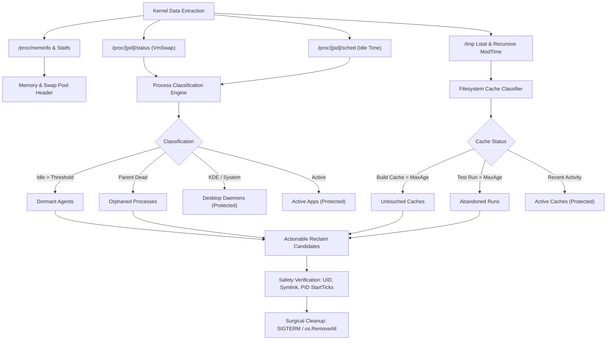

# swapaudit

[](https://github.com/jadmadi/swapaudit/actions/workflows/ci.yml)
[](https://github.com/jadmadi/swapaudit/actions/workflows/release.yml)
[](WaqfDPL-1.0.md)
[](LICENSE-AGPL.txt)

Auditor and surgical cleanup tool for swap memory, RAM, and in-memory caches on Linux.

```
+--------------------------------------------------------------------------------------------------+
| ◆  SWAP & IN-MEMORY CACHE AUDITOR                                                                |
+--------------------------------------------------------------------------------------------------+
  Swap  [#######.........]  48.5%   8.3 GB /  17.1 GB (free 8.8 GB)
  RAM   [######..........]  39.2%  12.2 GB /  31.2 GB (avail 19.0 GB)
  /tmp  [#######.........]  47.7%   7.4 GB /  15.6 GB (free 8.2 GB)

+--------------------------------------------------------------------------------------------------+
| ◆  Actionable Reclaim Candidates (Cleanable: 5.9 GB)                                             |
+--------------------------------------------------------------------------------------------------+
  PID       | Target / Name      | Category         |       Size |     Idle | Action
  ----------+--------------------+------------------+------------+----------+-----------------------
  > 2603976 | agy                | dormant-agents   |   338.8 MB |   20h45m | End dormant session
  > -       | go-build704621508  | untouched-caches |   338.7 MB |   20h46m | Prune untouched cache
  > -       | go-build4040953814 | untouched-caches |   324.9 MB |   20h46m | Prune untouched cache
  > -       | go-build2314295942 | untouched-caches |   304.2 MB |     1d9h | Prune untouched cache
  ... and 652 smaller candidates (1.9 GB). Run with --all to inspect full list.
```

## Why swapaudit exists

Modern developer workstations run dozens of language server isolates, container runtimes,
headless browsers, and local AI agent worker processes. Over time, inactive background processes
accumulate anonymous memory pages that the Linux kernel pages out to disk.

Meanwhile, temporary build directories and test suites allocate gigabytes of volatile storage inside
`/tmp`, which mounts as a tmpfs RAM-backed filesystem. When RAM pressure rises, tmpfs pages compete
directly with process memory for physical space and swap blocks.

Standard tools like free, top, and vmstat report aggregate swap usage or resident set size.
They cannot answer three critical triage questions:

- Which dormant processes pushed hundreds of megabytes into swap hours or days ago?
- Which abandoned test workspaces in `/tmp` are inflating the kernel tmpfs backing store?
- What can be safely cleaned right now without disrupting running applications?

swapaudit solves this with zero dependencies, sub-second execution, and verified safety guards.
For comparisons with earlyoom, systemd-oomd, zram, smem, and vmstat, see
[docs/comparison/](docs/comparison/).

## Architecture and triage pipeline

Kernel memory subsystems interact across physical RAM, swap space, and tmpfs mounts:

```
                     PHYSICAL RAM & KERNEL MEMORY SUBSYSTEMS
  =============================================================================
  +---------------------------------------------------------------------------+
  |                               Physical RAM                                |
  |  +-----------------------+  +-------------------+  +-------------------+  |
  |  | Active Applications   |  | Inode / PageCache |  | /tmp tmpfs Mount  |  |
  |  | (RSS in Memory)       |  | (Kernel Buffers)  |  | (RAM-backed disk) |  |
  |  +-----------------------+  +-------------------+  +-------------------+  |
  +---------------------------------------------------------------------------+
                                |                                  |
                                | (Kernel Anonymous Page Out)      | (Swap backed)
                                v                                  v
  +---------------------------------------------------------------------------+
  |                            Linux Swap Space                               |
  |  +-----------------------+  +-------------------+  +-------------------+  |
  |  | Dormant Agent Workers |  | Idle Shell Stacks |  | Swapped tmpfs Blks|  |
  |  | (VmSwap in /proc)     |  | (Aggregated)      |  | (Stale runs)      |  |
  |  +-----------------------+  +-------------------+  +-------------------+  |
  +---------------------------------------------------------------------------+
```

The visual triage pipeline extracts kernel data, classifies occupants, and enforces safety guards:



## Key capabilities and safety rails

- Pure Go and zero dependencies: written entirely with standard library and Linux syscalls.
- Sub-second audit: inspects kernel structures directly without background daemons or agents.
- Precise process classification: detects dormant AI coding agents, browser MCP servers, and orphans.
- Shell flood protection: aggregates dozens of idle subshells into single compact rows.
- Kernel start-ticks verification: validates process start ticks immediately before sending SIGTERM
  to guarantee immunity against PID reuse kills.
- Strict path confinement: only prunes files inside `/tmp` or `/var/tmp` owned by your active user UID.
- Symlink rejection: skips symlinks at top-level and nested walk boundaries to protect real files.
- Stream size limits: self-updater bounds downloads to 50MB and checksum files to 1MB.
- Dynamic terminal formatting: adapts to terminal width, supports NO_COLOR, and includes ASCII fallback.

## Installation methods

Pre-built standalone binary:

Download the latest static binary for your architecture (amd64, arm64, armv7, riscv64):

```bash
curl -sSL https://github.com/jadmadi/swapaudit/releases/latest/download/swapaudit-linux-amd64 \
  -o ~/.local/bin/swapaudit && chmod +x ~/.local/bin/swapaudit
```

In-place self-upgrade:

If swapaudit is already installed on your system, upgrade it to the latest release with:

```bash
swapaudit upgrade
```

Build from source with Makefile:

```bash
git clone https://github.com/jadmadi/swapaudit.git
cd swapaudit
make build
make install
```

Via go install:

```bash
go install github.com/jadmadi/swapaudit/cmd/swapaudit@latest
```

Requirements: Linux with kernel 3.10 or newer (tested on Linux 6.x with systemd and glibc).

## Common workflows and examples

Basic audit:

Run swapaudit without arguments to view overall memory status and actionable candidates:

```bash
swapaudit
```

Sorting and filtering:

Sort occupants by age instead of size to reveal long-dormant processes:

```bash
swapaudit --sort age
```

Inspect all individual processes without shell aggregation:

```bash
swapaudit --all
```

Set custom display row limits:

```bash
swapaudit --limit 25
```

Surgical cleanup commands:

Simulate all cleanup actions without deleting files or killing processes:

```bash
swapaudit --clean-all --dry-run
```

Prune stale build caches untouched for over 12 hours:

```bash
swapaudit --clean-untouched
```

Prune abandoned test suites and review runs in `/tmp`:

```bash
swapaudit --clean-abandoned
```

End dormant agent sessions idle for over 2 hours:

```bash
swapaudit --clean-dormant
```

Clean all safe targets with interactive confirmation:

```bash
swapaudit --clean-all
```

Bypass interactive prompts in automated cron jobs:

```bash
swapaudit --clean-untouched -y
```

Customization flags:

Add custom project prefixes for `/tmp` test runs:

```bash
swapaudit --tmp-pattern "myproject-*" --tmp-pattern "e2e-run-*"
```

Customize the cutoff age for stale caches (default: 12h):

```bash
swapaudit --max-age 6h
```

Customize the idle threshold for dormant agent sessions (default: 2h):

```bash
swapaudit --idle-threshold 45m
```

Force plain ASCII output for minimal terminal environments:

```bash
swapaudit --ascii
```

Disable ANSI colors:

```bash
swapaudit --no-color
```

Print version information:

```bash
swapaudit --version
```

## Machine-readable JSON output

`--json` emits exactly one versioned document to stdout for scripts, statuslines,
editors, and CI. The mode is read-only and never runs the update check, prints a
banner, or truncates the item list.

```bash
swapaudit --json > snapshot.json
swapaudit --json --no-command > snapshot.json   # omit command lines for logs
```

The document carries system counters, thresholds, per-category totals, and every
raw item. Items use a canonical order, nullable fields are explicit, and arrays
are never `null`. See [docs/json-schema.md](docs/json-schema.md) for the full
field table, nullability rules, exit codes, and consumer recipes.

```bash
swapaudit --json | jq -r '.totals.cleanable_bytes'
```

Cleanup, `--dry-run`, `--yes`, and interactive flags are rejected with exit `2`
when combined with `--json`.

## In-place upgrades and release checks

Automated daily background check:

swapaudit checks GitHub releases in the background once every 24 hours. When an update exists,
it prints a subtle notice after the audit report completes.

Disable update check:

Pass `--no-update-check` or set `SWAPAUDIT_NO_UPDATE_CHECK=1` in your shell environment:

```bash
swapaudit --no-update-check
```

In-place self-upgrade:

Run `swapaudit upgrade` to upgrade your installed binary in place. The updater fetches release
metadata, streams the release binary with a 50MB limit, verifies SHA256 checksums, and replaces
the executable atomically.

```bash
swapaudit upgrade
```

## CLI reference

| Command or flag         | Default  | Description                                                           |
| :---------------------- | :------- | :-------------------------------------------------------------------- |
| upgrade                 | -        | Check GitHub releases and upgrade swapaudit in place                  |
| --sort <size\|age>      | size     | Sort column for occupant tables: size or age                          |
| --limit <N>             | 12       | Maximum rows to display in the main occupants table                   |
| --all                   | false    | Show all individual processes without grouping                        |
| --clean-untouched       | false    | Prune stale build caches untouched beyond max-age                     |
| --clean-abandoned       | false    | Prune abandoned test suites and review runs in /tmp                   |
| --clean-dormant         | false    | Terminate dormant agent sessions idle beyond threshold                |
| --clean-orphaned        | false    | Terminate orphaned agent sessions whose parent shell died             |
| --clean-tmp             | false    | Prune all cleanable /tmp caches (untouched and abandoned)             |
| --clean-all             | false    | Run all safe cleanups (untouched, abandoned, dormant, orphaned)       |
| --dry-run               | false    | Simulate actions without deleting files or killing processes          |
| -y, --yes               | false    | Automatically answer yes to confirmation prompts                      |
| --max-age <duration>    | 12h      | Age cutoff duration for stale /tmp directories                        |
| --idle-threshold <dur>  | 2h       | Idle duration threshold for classifying dormant agents                |
| --tmp-pattern <pattern> | (list)   | Additional pattern for temporary artifacts in /tmp (repeatable)       |
| --no-update-check       | false    | Skip background 24-hour release check                                 |
| --json                  | false    | Emit one stable machine-readable JSON document                        |
| --no-command            | false    | Omit command lines from JSON output (requires --json)                 |
| --ascii                 | false    | Use plain ASCII glyphs instead of Unicode box characters              |
| --no-color              | false    | Disable ANSI color highlighting                                       |
| -v, --version           | false    | Print swapaudit version and build metadata                            |
| -h, --help              | false    | Show CLI usage help message                                           |

## Project layout and development

The project follows a standard modular Go architecture:

- `cmd/swapaudit`: application entry point.
- `internal/app`: CLI execution coordinator and flag parser.
- `internal/cache`: `/tmp` cache scanner, pattern matcher, and mtime depth analysis.
- `internal/cleaner`: surgical pruning and process termination with verification guards.
- `internal/model`: shared data types for memory, processes, and categories.
- `internal/proc`: kernel `/proc` parsers for status, meminfo, sched, and cmdline.
- `internal/snapshot`: versioned machine-readable schema and pure document builder.
- `internal/term`: terminal layout, ANSI color engine, and text width calculations.
- `internal/triage`: process classification and shell aggregation logic.
- `internal/updater`: release checking and atomic binary self-upgrades.
- `internal/version`: version string formatting and build metadata.

Running tests and linters:

```bash
./scripts/lint
./scripts/test
```

For contribution instructions, see [CONTRIBUTING.md](CONTRIBUTING.md).
For project governance and security policies, see [GOVERNANCE.md](GOVERNANCE.md)
and [SECURITY.md](SECURITY.md).
For agent-specific operating guidance, see [AGENTS.md](AGENTS.md).

## Dual license: WaqfDPL and GNU AGPLv3

swapaudit is free software dual-licensed under:

1. Waqf Digital Public License, Level 2: Binding Attribution (WaqfDPL-Mulzim 1.0)
   Dedicated as a perpetual digital endowment (Waqf) for the sake of Allah to benefit
   developers and communities worldwide. Requires reciprocal copyleft and author attribution.
   Consult the WaqfDPL registry at https://github.com/WaqfTech/waqf-license-draft.
   See [WaqfDPL-1.0.md](WaqfDPL-1.0.md) for the full legal text.

2. GNU Affero General Public License v3.0 or later (AGPL-3.0-or-later)
   Guarantees reciprocal software freedom under the Free Software Foundation copyleft framework.
   See [LICENSE-AGPL.txt](LICENSE-AGPL.txt) and https://www.gnu.org/licenses/agpl-3.0.html
   for the full legal text.

Users and distributors may choose to follow the terms of either license.

Author: Jad Madi (https://github.com/jadmadi)
