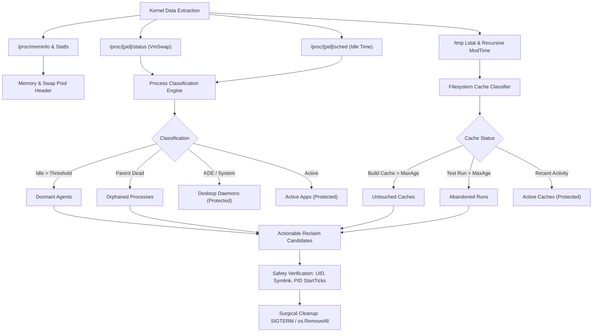

# swapaudit

[](https://github.com/jadmadi/swapaudit/actions/workflows/ci.yml)
[](https://github.com/jadmadi/swapaudit/actions/workflows/release.yml)
[](WaqfDPL-1.0.md)
[](LICENSE-AGPL.txt)

Auditor and surgical cleanup tool for swap memory and in-memory caches on Linux.

```
+--------------------------------------------------------------------------------------------------+
| ◆  SWAP & IN-MEMORY CACHE AUDITOR                                                                |
+--------------------------------------------------------------------------------------------------+
  Swap  [#######.........]  48.5%   8.3 GB /  17.1 GB (free 8.8 GB)
  RAM   [######..........]  39.2%  12.2 GB /  31.2 GB (avail 19.0 GB)
  /tmp  [#######.........]  47.7%   7.4 GB /  15.6 GB (free 8.2 GB)

+--------------------------------------------------------------------------------------------------+
| ◆  Actionable Reclaim Candidates (Cleanable: 5.9 GB)                                             |
+--------------------------------------------------------------------------------------------------+
  PID       | Target / Name      | Category         |       Size |     Idle | Action
  ----------+--------------------+------------------+------------+----------+-----------------------
  > 2603976 | agy                | dormant-agents   |   338.8 MB |   20h45m | End dormant session
  > -       | go-build704621508  | untouched-caches |   338.7 MB |   20h49m | Prune untouched cache
  > -       | go-build4040953814 | untouched-caches |   324.9 MB |   20h46m | Prune untouched cache
  > -       | go-build2314295942 | untouched-caches |   304.2 MB |     1d9h | Prune untouched cache
  ... and 652 smaller candidates (1.9 GB). Run with --all to inspect full list.
```

## First principles: the memory bloat paradox

Modern developer workstations run dozens of headless browser instances, language server isolates,
container runtimes, and local AI agent worker processes. Over time, inactive background processes
accumulate anonymous memory pages that the Linux kernel pages out to disk.

Meanwhile, temporary build directories and test suites allocate gigabytes of volatile storage inside
`/tmp`, which mounts as a `tmpfs` RAM-backed filesystem. When RAM pressure rises, `tmpfs` pages compete
directly with process memory for physical space and swap blocks.

Standard tools like `free`, `top`, and `vmstat` report aggregate swap usage or resident set size, but
they cannot answer three critical triage questions:

1. Which dormant processes pushed hundreds of megabytes into swap hours or days ago?
2. Which abandoned test workspaces in `/tmp` are inflating the kernel tmpfs backing store?
3. What can be safely cleaned right now without disrupting running applications?

swapaudit solves this with zero dependencies, sub-second execution, and verified safety guards.

## Concept map: memory subsystems and triage architecture

```
                     PHYSICAL RAM & KERNEL MEMORY SUBSYSTEMS
  =============================================================================
  +---------------------------------------------------------------------------+
  |                               Physical RAM                                |
  |  +-----------------------+  +-------------------+  +-------------------+  |
  |  | Active Applications   |  | Inode / PageCache |  | /tmp tmpfs Mount  |  |
  |  | (RSS in Memory)       |  | (Kernel Buffers)  |  | (RAM-backed disk) |  |
  |  +-----------------------+  +-------------------+  +-------------------+  |
  +---------------------------------------------------------------------------+
                               |                                  |
                               | (Kernel Anonymous Page Out)      | (Swap backed)
                               v                                  v
  +---------------------------------------------------------------------------+
  |                            Linux Swap Space                               |
  |  +-----------------------+  +-------------------+  +-------------------+  |
  |  | Dormant Agent Workers |  | Idle Shell Stacks |  | Swapped tmpfs Blks|  |
  |  | (VmSwap in /proc)     |  | (Aggregated)      |  | (Stale runs)      |  |
  |  +-----------------------+  +-------------------+  +-------------------+  |
  +---------------------------------------------------------------------------+
```

### Visual triage pipeline



## Key capabilities

- Pure Go and zero dependencies: written entirely with standard library and Linux syscalls.
- Sub-second audit: inspects kernel structures directly without background daemons or agents.
- Precise process classification: detects dormant AI coding agents, browser MCP servers, and orphans.
- Shell flood protection: aggregates dozens of idle subshells into single compact rows.
- Complete safety rails:
  - Validates process start ticks immediately before sending SIGTERM to prevent PID reuse kills.
  - Verifies UID ownership and rejects symlinks before pruning `/tmp` cache folders.
  - Completely segregates filesystem pruning from process termination commands.
- Adaptive terminal output:
  - Dynamically calculates column widths and clamps display between 80 and 120 columns.
  - Automatically turns off colors when stdout is redirected or NO_COLOR is set.
  - Includes full ASCII mode (--ascii) for legacy consoles and raw logs.

## Installation

### From source

```bash
git clone https://github.com/jadmadi/swapaudit.git
cd swapaudit
make build
```

To install directly to `~/.local/bin/swapaudit`:

```bash
make install
```

### Via go install

```bash
go install github.com/jadmadi/swapaudit/cmd/swapaudit@latest
```

Requirements: Linux with kernel 3.10 or newer (tested on Linux 6.x with systemd and glibc).

## Usage guide

### Basic inspection

Run swapaudit without arguments to view overall memory status and actionable candidates:

```bash
swapaudit
```

### Sorting and filtering

Sort occupants by age instead of size:

```bash
swapaudit --sort age
```

Inspect all individual processes without shell aggregation:

```bash
swapaudit --all
```

Set custom display row limits:

```bash
swapaudit --limit 25
```

### Surgical cleanup commands

Simulate all cleanup actions without deleting files or killing processes:

```bash
swapaudit --clean-all --dry-run
```

Prune stale build caches untouched for over 12 hours:

```bash
swapaudit --clean-untouched
```

Prune abandoned test suites and review runs:

```bash
swapaudit --clean-abandoned
```

End dormant agent sessions idle for over 2 hours:

```bash
swapaudit --clean-dormant
```

Clean all safe targets with interactive confirmation:

```bash
swapaudit --clean-all
```

Bypass interactive prompts in automated cron jobs:

```bash
swapaudit --clean-untouched -y
```

### Customization flags

Add custom project prefixes for `/tmp` test runs:

```bash
swapaudit --tmp-pattern "myproject-*" --tmp-pattern "e2e-run-*"
```

Customize the cutoff age for stale caches (default: 12h):

```bash
swapaudit --max-age 6h
```

Customize the idle threshold for dormant agent sessions (default: 2h):

```bash
swapaudit --idle-threshold 45m
```

Force plain ASCII output for minimal terminal environments:

```bash
swapaudit --ascii
```

Disable ANSI colors:

```bash
swapaudit --no-color
```

Print version information:

```bash
swapaudit --version
```

## CLI flag reference

| Flag | Default | Description |
| :--- | :--- | :--- |
| --sort | size | Sort column for occupant tables: 'size' or 'age' |
| --limit | 12 | Maximum rows to display in the main occupants table |
| --all | false | Show all individual processes without grouping |
| --clean-untouched | false | Prune stale build caches untouched beyond max-age |
| --clean-abandoned | false | Prune abandoned test suites and review runs in /tmp |
| --clean-dormant | false | Terminate dormant agent sessions idle beyond threshold |
| --clean-orphaned | false | Terminate orphaned agent sessions whose parent shell died |
| --clean-tmp | false | Prune all cleanable /tmp caches (untouched + abandoned) |
| --clean-all | false | Run all safe cleanups (untouched + abandoned + dormant + orphaned) |
| --dry-run | false | Simulate actions without deleting files or killing processes |
| -y, --yes | false | Automatically answer yes to confirmation prompts |
| --max-age | 12h | Age cutoff duration for stale /tmp directories |
| --idle-threshold | 2h | Idle duration threshold for classifying dormant agents |
| --tmp-pattern | (list) | Additional pattern for temporary artifacts in /tmp |
| --ascii | false | Use plain ASCII glyphs instead of Unicode box characters |
| --no-color | false | Disable ANSI color highlighting |
| -v, --version | false | Print swapaudit version and build metadata |

## Dual license: WaqfDPL and GNU AGPLv3

swapaudit is free software dual-licensed under:

1. Waqf Digital Public License, Level 2: Binding Attribution (WaqfDPL-Mulzim 1.0)
   Dedicated as a perpetual digital endowment (Waqf) for the sake of Allah to benefit
   developers and communities worldwide. Requires reciprocal copyleft and author attribution.
   Consult the WaqfDPL registry at https://github.com/WaqfTech/waqf-license-draft.
   See WaqfDPL-1.0.md for the full legal text.

2. GNU Affero General Public License v3.0 or later (AGPL-3.0-or-later)
   Guarantees reciprocal software freedom under the Free Software Foundation copyleft framework.
   See LICENSE-AGPL.txt and https://www.gnu.org/licenses/agpl-3.0.html for the full legal text.

Users and distributors may choose to follow the terms of either license.

Author: Jad Madi (https://github.com/jadmadi)
